<h1 align="center">diskOS kopi</h1>

<p align="center">
  <b>Custom firmware for the FiiO Snowsky Disc.</b><br>
  Three themes made for the round screen: <b>NTDisk</b>, <b>iDisc</b> and <b>Null</b>.<br>
  Built on <a href="https://github.com/zmd22/diskos-disco">zmd22's diskOS Disco! 3.0.1</a>, which is built on
  <a href="https://github.com/b0hemia/diskos">b0hemia's diskOS</a>.
</p>

<p align="center">
  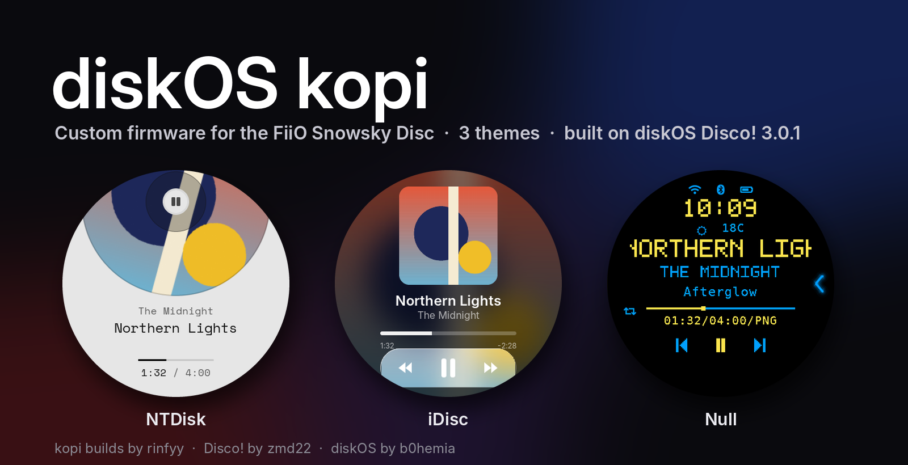
</p>

<p align="center">
  
  
  
  <a href="ui/COPYING"></a>
</p>

<p align="center">
  <a href="#whats-in-kopi"><b>What's in kopi</b></a> ·
  <a href="#ntdisk">NTDisk</a> ·
  <a href="#idisc">iDisc</a> ·
  <a href="#null">Null</a> ·
  <a href="#install"><b>Install</b></a> ·
  <a href="#updates-from-the-sd-card">SD updates</a> ·
  <a href="https://github.com/rinfyy/diskos-kopi/releases">Releases</a> ·
  <a href="#thanks">Thanks</a>
</p>

---

> [!CAUTION]
> **Best-effort hobby project, experimental, as-is, no liability.** Flashing rewrites the Disc's root filesystem;
> a power cut, a bad cable or an interrupted flash can leave it unbootable. Back up your music and keep the
> saved stock image somewhere safe before you start. kopi builds are test builds: they are cross-compiled with a
> different toolchain from the official Disco! releases and checked on renders and in an emulator, not on every
> Disc. Not affiliated with FiiO, Snowsky, Ingenic or zmd22's project.

## What's in kopi

**Latest: 3.0.1-kopi.33**: a **vinyl** record look with the album as its label, a play button that fades in
and out, Immersive with the top bar and a swipe-up back (the record grows into it), **+ Playlist** on the song
page, newest playlists first, **play straight through a folder**, and **Racer**, a top-down traffic game.

- **Three themes, and only three.** NTDisk, iDisc and Null; Disco, Squash, Zune, Ring, Braun and Stone are
  gone, which made the interface 1.3 MB smaller. A Disc on a removed theme starts in NTDisk.
- **Battery first.** Battery saver (Off / On / Auto at 20 %), a calmer main loop when nothing moves, and a
  battery page with how long a full charge lasts, screen off and on.
- **Wi-Fi file transfer.** Open the Disc's address in any browser on the same Wi-Fi, type the 4-digit code, and
  upload (files or whole folders), download, rename and delete on the SD card. It switches itself off when unused.
- **Vibe play mode.** Each song is followed by a similar one (SongSphere, genre, artist, length), and the queue
  carries on with similar songs when it runs out. The next queued song starts the moment the current one ends.
- **Hold the power button** for Shut down / Restart / Cancel. A short press turns the screen on and off.
- **Sleep timer, one tap away**: 15 min to 2 hours or end of song, from Quick Settings, Shortcuts or Settings.
- **Shortcuts for anything**: eight slots, any action, app, settings page or single setting.
- **Music screen made for thumbs**: a CD or a **vinyl** record; the top half of it does nothing (so the top menu is
  safe), tap it for the play button, hold for Immersive, hold the time 2 s to seek, tap the title for the lyric
  line, hold it for the song.
- **Immersive**: full-screen lyrics that stay centred, or the whole cover as a spinning CD with controls.
- **Equalizer**: an **IM4 Harman** preset (Fosi Audio IM4 toward the Harman in-ear target), Copy / Paste /
  Delete for USER presets, and a preamp up to +10 dB.
- **Settings that ask once.** Style changes ask "Restart / Later / Undo" when you leave the page; EQ edits ask
  "Keep / Undo".

Every release's full notes are in its zip's `README.md`.

## NTDisk

Monochrome with a red dot: a dot-matrix clock, a turning CD and full-screen lyrics. Five styles: Mix,
Dark, Light, **Cream** and **Midnight**.

<table>
<tr>
<td align="center" width="25%">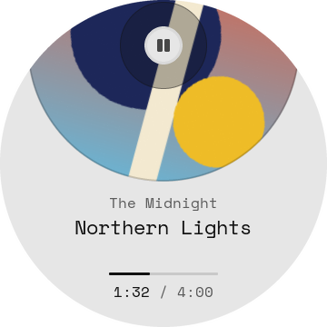<br><sub><b>Music</b>: the turning CD</sub></td>
<td align="center" width="25%">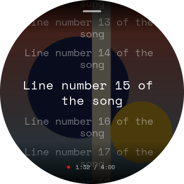<br><sub><b>Lyrics</b>, always centred</sub></td>
<td align="center" width="25%">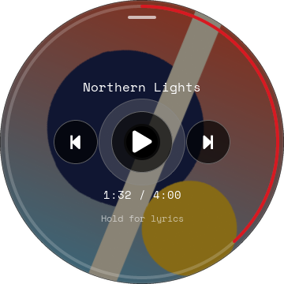<br><sub><b>Spinning album</b> Immersive</sub></td>
<td align="center" width="25%">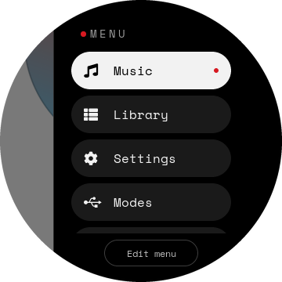<br><sub><b>Menu</b></sub></td>
</tr>
<tr>
<td align="center" width="25%">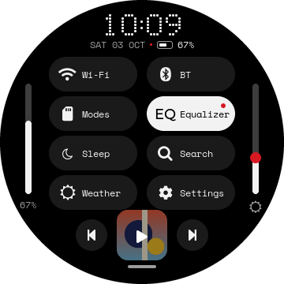<br><sub><b>Quick Settings</b></sub></td>
<td align="center" width="25%">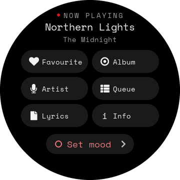<br><sub><b>Hold the title</b>: the song</sub></td>
<td align="center" width="25%">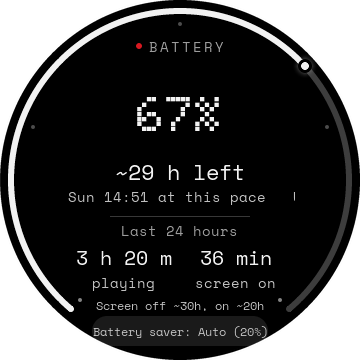<br><sub><b>Battery</b>: level and estimates</sub></td>
<td align="center" width="25%">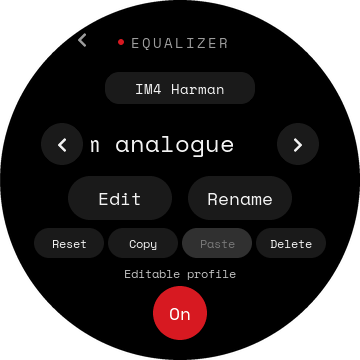<br><sub><b>Equalizer</b>: Copy, Paste, Delete</sub></td>
</tr>
<tr>
<td align="center" width="25%">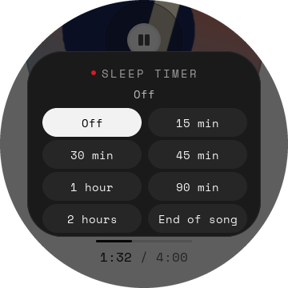<br><sub><b>Sleep timer</b></sub></td>
<td align="center" width="25%">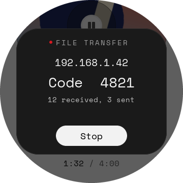<br><sub><b>File transfer</b>: address and code</sub></td>
<td align="center" width="25%">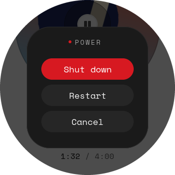<br><sub><b>Hold power</b></sub></td>
<td align="center" width="25%">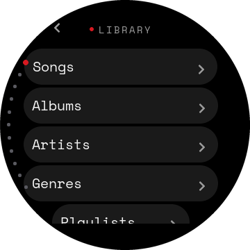<br><sub><b>Library</b></sub></td>
</tr>
<tr>
<td align="center" width="25%">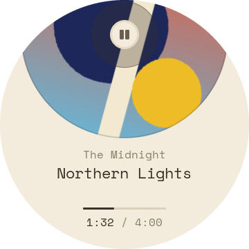<br><sub><b>Cream</b> style</sub></td>
<td align="center" width="25%">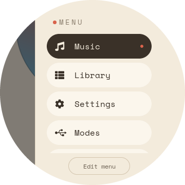<br><sub>Cream menu</sub></td>
<td align="center" width="25%">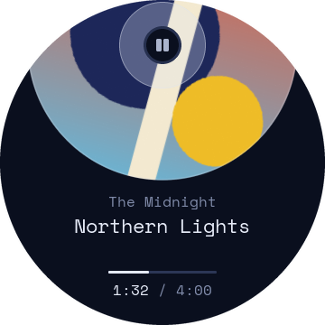<br><sub><b>Midnight</b> style</sub></td>
<td align="center" width="25%">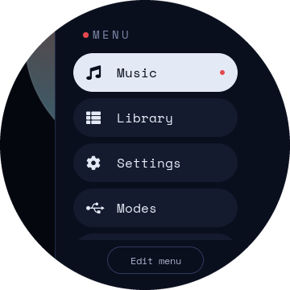<br><sub>Midnight menu</sub></td>
</tr>
</table>

## iDisc

Frosted glass over a soft wallpaper, inspired by modern phone design: glass that materializes instead of
fading, swells under your finger and thickens as it grows. Dark, Light or Automatic; Reduce motion for less of it.

<table>
<tr>
<td align="center" width="25%">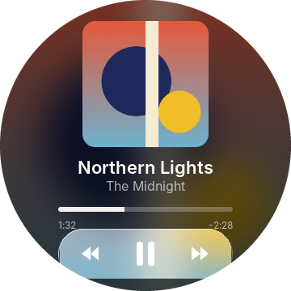<br><sub><b>Music</b></sub></td>
<td align="center" width="25%">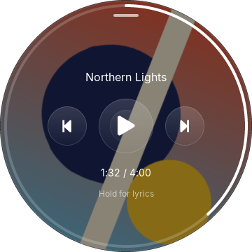<br><sub><b>Spinning album</b></sub></td>
<td align="center" width="25%">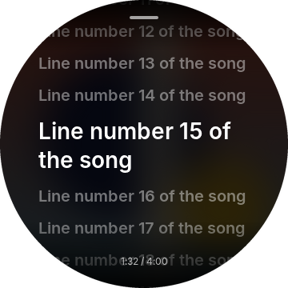<br><sub><b>Lyrics</b></sub></td>
<td align="center" width="25%">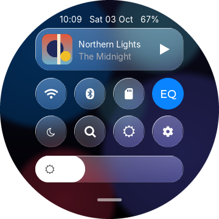<br><sub><b>Control Center</b></sub></td>
</tr>
<tr>
<td align="center" width="25%">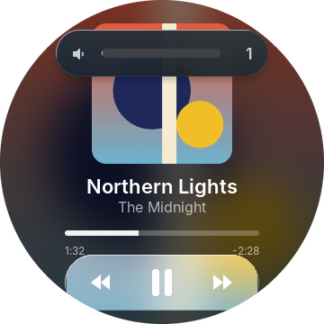<br><sub><b>Volume</b> capsule</sub></td>
<td align="center" width="25%">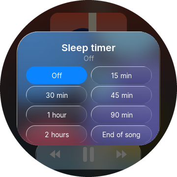<br><sub><b>Sleep timer</b></sub></td>
<td align="center" width="25%">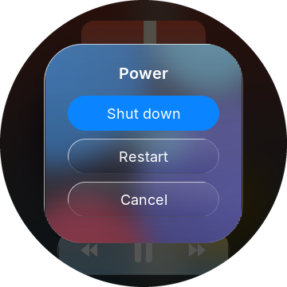<br><sub><b>Hold power</b></sub></td>
<td align="center" width="25%">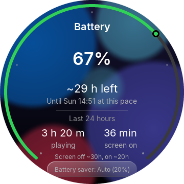<br><sub><b>Battery</b></sub></td>
</tr>
</table>

## Null

The original high-contrast look: big monospace type, your own colours.

<table>
<tr>
<td align="center" width="25%">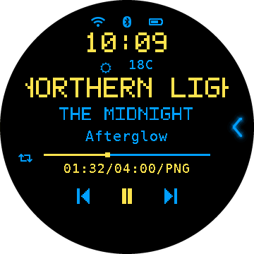<br><sub><b>Music</b></sub></td>
<td align="center" width="25%">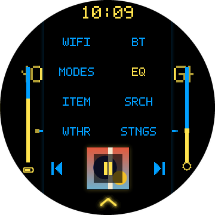<br><sub><b>Quick Settings</b></sub></td>
<td align="center" width="25%">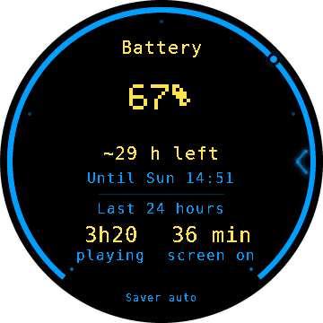<br><sub><b>Battery</b></sub></td>
<td align="center" width="25%">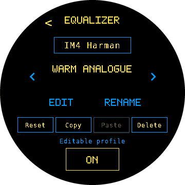<br><sub><b>Equalizer</b></sub></td>
</tr>
</table>

## Install

You need a Snowsky Disc on **FiiO firmware V2.57**, FiiO's official V2.57 firmware ZIP, a good USB data cable and
about 30 quiet minutes. kopi installs with zmd22's Disco! tools; you pick the kopi `mq_ui` instead of theirs.

> [!IMPORTANT]
> **Start from FiiO's stock V2.57 firmware** (or from Disco!). Installing over upstream diskOS or another diskOS
> build is not supported; restore stock first ([how](#going-back)).

**Already on Disco! (1.4.1 or newer): SD-card update.** Download the latest kopi zip from
[Releases](https://github.com/rinfyy/diskos-kopi/releases) and follow [Updates from the SD card](#updates-from-the-sd-card)
with its `mq_ui`. In the Windows app: **Update** → Version: **An mq_ui file on this PC**.

**First install from stock, on Windows:** download
**[diskOS-Disco-for-Windows.zip](https://github.com/zmd22/diskos-disco/releases/latest/download/diskOS-Disco-for-Windows.zip)**,
run `diskOS-Disco.exe`, and on its **Install** page choose Version: **An mq_ui file on this PC** and pick the kopi
`mq_ui`. Full guide: [diskOS Disco! for Windows](docs/WINDOWS.md).

**macOS:** [macOS installation guide](docs/MACOS.md), with `--ui path/to/kopi/mq_ui`.

**Linux:** the installer is upstream diskOS's (`./diskos-installer --help`).

```sh
git clone -b diskos-kopi https://github.com/rinfyy/diskos-kopi
cd diskos-kopi
sh ui/tools/owner-keys/diskos-keys.sh          # once: your update keys (keep the private keys safe)
cp diskos-keys/diskos-root.pub.pem payload/
./install.sh                                   # first time only: host setup
./diskos-installer install \
  --firmware SNOWSKY_DISC_update_20260909_v257.zip \
  --variant public \
  --ui path/to/kopi/mq_ui \
  --ota-key payload/diskos-root.pub.pem
```

Power the Disc off, hold **Volume Down** and plug in USB (the screen stays black). Check the summary line
`ota: ON … key sha256 xxxx` matches `sha256sum payload/diskos-root.pub.pem` before you answer `y`.

## Updates from the SD card

**On Windows:** the app's **Update** page signs an `mq_ui` with your keys and writes it to the SD card; choose
**An mq_ui file on this PC** and pick the kopi `mq_ui`. **On Linux:**

```sh
sh ui/tools/owner-keys/diskos-sign.sh path/to/mq_ui 3.0.1-kopi.33   # -> ./diskos-update/
```

Copy the whole `diskos-update` **folder** to the SD card root (kopi's Wi-Fi file transfer works too), then on the
Disc: **Settings › System › Maintenance › Update from SD Card › Update**, wait, restart. The new build runs as a
**trial**: play music for 3+ minutes so it's kept; if it fails, the Disc goes back to the previous one by itself.
More: [full SD update guide](docs/UPDATING.md).

## Build it yourself

```sh
cd ui
make CROSS=/opt/mipsel-n2008-musl-cross/bin/mipsel-linux-musl- mq_ui   # the Disc's binary
make CROSS= host-render                                                # desktop renderer for screenshots
make check-theme checkpunct                                            # style checks
```

The toolchain is musl-cross-make with [`ui/toolchain/mcm-config.mak`](ui/toolchain/mcm-config.mak) (MIPS32r2,
FP64, NaN2008, GCC 11.2). It reproduces Disco!'s official binaries byte for byte (kopi test builds use a different, compatible toolchain). More is in
[docs/DEV_WORKFLOW.md](docs/DEV_WORKFLOW.md) and [ui/README.md](ui/README.md).

**Shortcuts for a fresh machine.** You don't have to build the compiler: a prebuilt copy is attached to the
[`toolchain-gcc11.2`](https://github.com/zmd22/diskos-disco/releases/tag/toolchain-gcc11.2) pre-release (unpack it
into `/opt`). Release builds use the helper, which builds from tracked files only and checks the result:

```sh
python3 ui/tools/build_device.py --toolchain /opt/mipsel-n2008-musl-cross --cache <cache dir> --out <new dir> --approved
```

Rebuilding a tagged release this way gives the same `mq_ui` as the one in the release. For screenshots, the
renderer's `preview-<page>` pages (Music, Quick Settings, Settings...) expect a cover picture next to the output:
`host-render PRESET VARIANT preview-home 0 out.ppm` reads `out.png` as the cover. Theme numbers: Null 11, NTDisk 14, iDisc 15; variant 0 is dark, 1 light. Keep the desktop and Disc builds in separate
checkouts.

## Known limits

- **Testing status.** Each release says what was tried on a real Disc and what was only checked on a computer.
  The newest features of a release usually need some days of everyday use; please report what you find.
- **Start from stock.** Install on FiiO's stock V2.57 firmware. Installing over upstream diskOS or another diskOS
  build is not supported and can be buggy.
- **Disc keeps starting stock after installing?** A "Default UI: Stock" choice made earlier (in Disco or upstream
  diskOS) is kept in the Disc's data area, which flashing and firmware updates don't erase, so every new install still
  starts stock. Hold **Volume Up** while powering on to start Disco once, then set **Settings > System > Controls >
  Default UI** to **diskOS**. No need to flash again.
- **Switching between diskOS builds.** Switched to Disco from upstream diskOS or another build, and something looks or behaves wrong? **Settings > System > Maintenance > Reset diskOS Settings** gives the interface a fresh start; your music, Wi-Fi, Bluetooth, EQ and audio settings stay. Going back to stock in between does *not* clear what diskOS leaves on the Disc.
- **Windows:** Unsupported, but working as intended: confirmed several times by users, installs and SD updates included.
- **Firmware.** Made for FiiO firmware V2.57 only.
- **Cover cache.** Covers for Cover Flow and lists are cached on the SD card only while it has enough free space
  (500 MB). On a nearly full card, covers may stay blank.
- **If you suddenly see FiiO's own interface,** kopi stopped and the Disc fell back to the stock one; restart to
  return. Over SSH (Debug Mode), `/usr/data/diskos_boot.log` and `/usr/data/diskos_install.log` show why.
- **Languages.** Titles, artists and lyrics can be in Latin-script languages (including Vietnamese), Greek,
  Cyrillic, Thai, Korean, Japanese and common Chinese characters. Chinese, Japanese and Korean show in one smaller
  size. Right-to-left scripts (Hebrew, Arabic) and Indian scripts are not supported yet.
- **No online updates.** New versions come by signed SD-card update (kopi's Wi-Fi file transfer can copy the
  `diskos-update` folder for you) or a fresh install.

## Going back

Stock is never far:

- **Settings › System › Controls › Default UI › Stock** makes FiiO's interface the normal choice.
- Hold **Volume Up** from power-on to boot the other interface once.
- `./diskos-installer restore-stock` (Linux) puts the stock system back, using the backup made at install. Disco's
  settings stay in the Disc's data area (unused), so a later reinstall comes back with them. The Windows app keeps
  the backup in `%LOCALAPPDATA%\diskOS-Disco\backup`; keep a copy of it elsewhere too.

**What survives what** (flashing, restoring stock, FiiO updates, switching to upstream diskOS), and the fixes for the
usual surprises: [Flashing and switching interfaces](docs/SWITCHING.md).

## Documentation

| | |
|---|---|
| [Flashing and switching interfaces](docs/SWITCHING.md) | What stays and what goes when you flash, restore stock or switch |
| [Tour](docs/DISCO_TOUR.md) | Every screen, gesture and setting, with screenshots |
| [How-to](docs/HOWTO.md) | Short answers for everyday tasks |
| [Updating](docs/UPDATING.md) | Keys, signing, flashing once, troubleshooting |
| [macOS](docs/MACOS.md) | Install Disco on Apple Silicon or Intel Macs |
| [Windows](docs/WINDOWS.md) | diskOS Disco! for Windows: install and update from a Windows PC |
| [UI choices](docs/UI_CHOICES.md) | Why things look and work the way they do |
| [Releases](https://github.com/rinfyy/diskos-kopi/releases) | kopi builds, each with its notes |
| [Changelog](CHANGELOG.md) | Every Disco! release, newest first (before kopi) |
| [All docs](docs/README.md) | Optional apps, hardware notes, developer workflow, legal |

## Thanks

- **[zmd22](https://github.com/zmd22/diskos-disco)**, for diskOS Disco!: the touch UI, the Windows app, the installer flow and the signed SD updates this fork is built on. kopi starts from Disco! 3.0.1.
- **[namastecoconut-imagined](https://github.com/namastecoconut-imagined/diskos-disco-zune)**, for the original Zune theme: its Metro-inspired direction, typography, home menu, music screen and library presentation. The Disco adaptation builds on that design and implementation; zmd22’s follow-up focuses on integration, readability and controls. [Original author’s commits](https://github.com/namastecoconut-imagined/diskos-disco-zune/commits?author=namastecoconut-imagined).

- **[b0hemia](https://github.com/b0hemia/diskos)**, for diskOS itself: the reverse engineering, the installer,
  the boot and recovery chain, the signed-update design and the whole UI this project grew from. None of this
  exists without that work. If you enjoy diskOS, [support b0hemia on Ko-fi](https://ko-fi.com/b0hemia).
- **diskOS contributors**: everyone who reported, tested and patched upstream.
- **[ingvarr777](https://github.com/ingvarr777)**, for Ogg Opus support (diskOS PR #19) and the careful bug reports
  behind 1.4.1 (issues #1–#8).
- **[LVGL](https://lvgl.io)** for the graphics library, **SQLite**, **jsmn**, **musl**,
  **[musl-cross-make](https://github.com/richfelker/musl-cross-make)**, the **Inter**, **Montserrat** and
  **Font Awesome** fonts, and every project listed in [NOTICE.md](NOTICE.md).
- FiiO / Snowsky for a lovely little round player. This project is **not affiliated with or endorsed by FiiO,
  Snowsky or Ingenic**.

### A note on the contributor list

The history before kopi is zmd22's diskOS Disco! (early commits show an author called "disco" because of a
misconfigured email; they were made by zmd22). The kopi builds start after Disco! 3.0.1.

## License

The installer, scripts and docs are **MIT** ([LICENSE](LICENSE)). The on-device interface in [ui/](ui/) is
**GPL-3.0-or-later** ([ui/COPYING](ui/COPYING)). Third-party terms are in [NOTICE.md](NOTICE.md),
[SPL_SOURCE.md](SPL_SOURCE.md) and [licenses/](licenses/).

> [!WARNING]
> Never share generated `diskos_*.bin` images: they contain FiiO's root filesystem. Share the installer and let
> people build from their own firmware.
